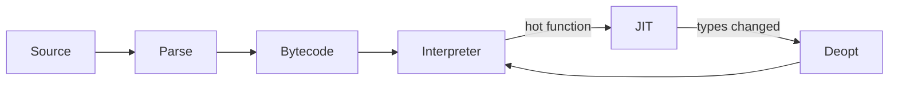
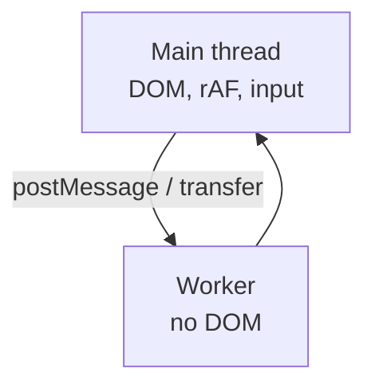

# Notes 07 — V8, пам’ять, тести

Досліди для пари: [`practice/lab-07-practice/`](practice/lab-07-practice/)

Поруч із лабою: [lab-07-engine-performance-testing.md](lab-07-engine-performance-testing.md).

DevTools (Performance, Memory) + термінал. Цифри записуй *до* оптимізації. Питання «чому гальмує» на співбесіді часто зводяться до GC і форм об’єктів.

Етапи здачі (**M1–M4**):

| | Що зробити | Як перевірити |
|---|---|---|
| **M1** | набір тестів симуляції | `npm test` падає, якщо зламати `integrate` |
| **M2** | e2e (тест як живий користувач у браузері) + CI (автоперевірка на GitHub) | тест у браузері + зелена галочка на пуші |
| **M3** | профіль, прибрати hitch, заміряти знову | у README: fps/GC до і після |
| **M4** | боти, Worker, навантаження сервера | цифри: скільки ботів тримає loop |

**GC** (garbage collection) — збирач сміття: звільняє пам’ять і на мить зупиняє JS; у грі це **hitch** (ривок кадру). **JIT** — компіляція «на льоту» гарячих функцій. **Deopt** — V8 викинув швидку версію, бо типи раптом змінилися. **Pool** — повторно використовуєш об’єкти куль замість `new` щокадру.

---

## Ідея

V8: парсить → байткод → за гарячими функціями JIT. Об’єкти з однаковою формою полів — **hidden class**; додав `.z` посеред масиву — поліморфізм, повільніше. GC зупиняє світ: у грі це hitch. Другий потік JS у вкладці — лише **Worker** (Lab 1: головний потік один).

Тести (Vitest, property tests, Playwright) — щоб рефакторинг pooling не зламав фізику.





---

## 1. Deopt на очах

```bash
node --allow-natives-syntax -e "function add(a,b){return a+b}; %PrepareFunctionForOptimization(add); for(let i=0;i<1e6;i++) add(i,1); %OptimizeFunctionOnNextCall(add); add(1,2); console.log(%GetOptimizationStatus(add)); add('a','b'); console.log(%GetOptimizationStatus(add))"
```

**Очікуй:** статус зміниться після `add('a','b')` — функцію деоптимізували (число + рядок). Розбір бітів: пошукай `GetOptimizationStatus bits`.

`%PrepareFunctionForOptimization` перед `%OptimizeFunctionOnNextCall` — вимога сучасного V8: на Node 26 без нього процес падає з fatal error (на Node 22 ще працює й без нього).

---

## 2. Форма об’єктів vs TypedArray

```js
const n = 1e6
const a = Array.from({ length: n }, (_, i) => ({ x: i, y: i }))
const b = Array.from({ length: n }, (_, i) =>
  i % 10 === 0 ? { x: i, y: i, z: 0 } : { x: i, y: i },
)
function sumX(arr) {
  let s = 0
  for (let i = 0; i < arr.length; i++) s += arr[i].x
  return s
}
console.time('mono')
sumX(a)
console.timeEnd('mono')
console.time('poly')
sumX(b)
console.timeEnd('poly')
```

**Очікуй:** з двома формами, як тут, різниці майже немає: дві-чотири форми V8 кешує майже так само дешево, як одну. Повільно стає від п’яти форм (мегаморфний виклик): у [practice](practice/lab-07-practice/) ~1.3 мс на одній формі проти ~3.9 мс на 8 формах. Далі ті самі `x` у `Float32Array` — зазвичай ще швидше і без об’єктів для GC.

---

## 3. Профіль гри

DevTools → Performance → 10 с польоту. Знайди жовті/сірі блоки GC. Memory → allocation — хто алокує (кулі?). Запиши **до** pooling.

---

## 4. Transfer vs clone у Worker

```js
const w = new Worker(URL.createObjectURL(new Blob(['onmessage=e=>postMessage(e.data)'])))
function once(buf, transfer) {
  return new Promise((res) => {
    w.onmessage = () => res({ left: buf.byteLength, ms: performance.now() - t })
    const t = performance.now()
    transfer ? w.postMessage(buf, [buf]) : w.postMessage(buf)
  })
}
const a = new ArrayBuffer(50 * 1024 * 1024)
console.log(await once(a, false))
const b = new ArrayBuffer(50 * 1024 * 1024)
console.log(await once(b, true))
```

**Очікуй:** після transfer у відправника `byteLength === 0`; clone лишає буфер і копіює 50 MB.

---

## 5. Property test (випадкові входи, не один приклад)

```js
// vitest + fast-check у проєкті лаби
// fc.assert(fc.property(fc.float({ noNaN: true }), x => Math.fround(x) === x))
```

`float` (32 біти) проходить; `fc.double()` — ні. Без `noNaN` `fc.float()` генерує й `NaN` і приблизно в кожному п’ятому запуску падає на ньому, бо `NaN === NaN` — `false`: «будь-яке число» включає `NaN`, і property test це знайде. Бібліотека **звужує** контрприклад (*shrunk*): покаже найменший дріб, на якому твердження бреше.

---

## У проєкті

Спочатку тест на `integrate` і колізії, потім pool куль (перевикористання об’єктів), потім (якщо треба) worker. Без цифр з Performance оптимізація — ворожіння.

---

## На співбесіді

- Що таке hidden class / shape. Чому додати поле «іноді» в об’єкти масиву дорого.
- Чому GC дає hitch у грі. Коли object pool має сенс, а коли ні.
- Main thread vs Worker. Що можна перенести, що ні (DOM).
- Як би ти довів, що рефакторинг не зламав фізику (тест, не «ну я пограв»).
