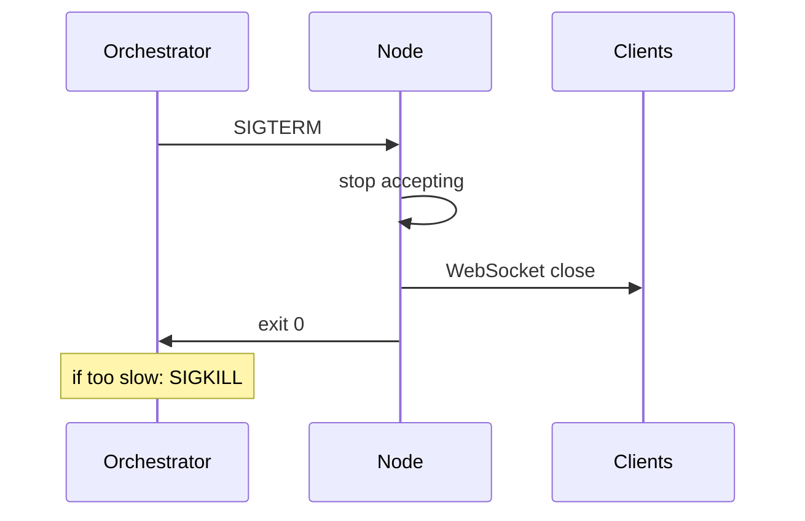
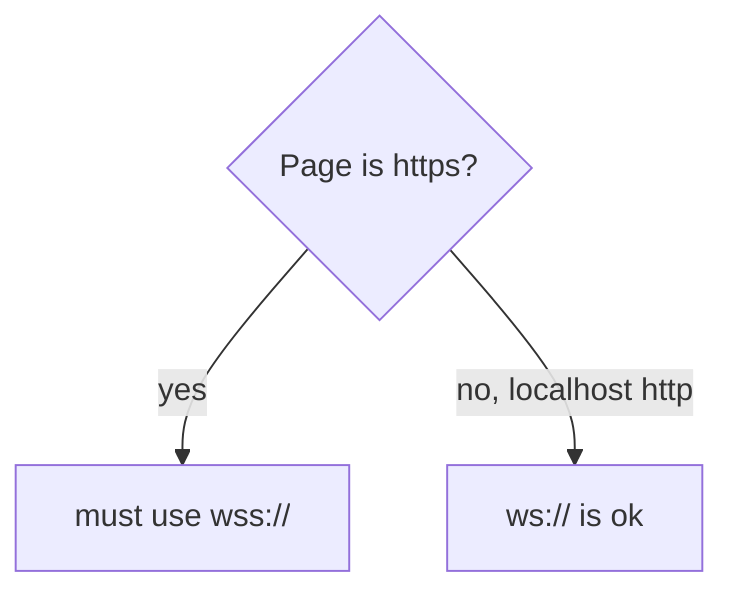

# Notes 08 — Задеплоїти і не впасти

Досліди для пари: [`practice/lab-08-practice/`](practice/lab-08-practice/)

Поруч із лабою: [lab-08-ship-it.md](lab-08-ship-it.md).

Термінал, Docker, браузер. Мета пари/вечора: **URL, з якого двоє людей грають**, не «у мене на ноутбуці працює». На співбесіді про прод питають сигнали, секрети й «чому не ws:// з https».

Етапи здачі (**M1–M4**):

| | Що зробити | Як перевірити |
|---|---|---|
| **M1** | процес як у проді | `SIGTERM` → вихід 0, клієнти бачать close |
| **M2** | захист: origin, ліміти, WSS | з чужого сайту сокет не відкриється як попало |
| **M3** | Docker + CI (автоперевірка на пуші) | `docker build` і деплой з пайплайна |
| **M4** | публічний URL і фініш | двоє людей зайшли, README/відео на місці |

**SIGTERM** — сигнал «закрийся чемно». **SIGKILL** — «вбити зараз», процес не встигає прибратись. **Graceful shutdown** — дослухати клієнтів і вийти з кодом 0. **WSS** — WebSocket поверх TLS (як HTTPS для сокета). **Origin** — з якого сайту відкрили з’єднання. **Mixed content** — сторінка `https://`, а сокет `ws://` (браузер забороняє).

---

## Ідея

Прод — інший звір: процес убивають сигналом, проксі ріже idle WebSocket, HTTPS сторінка не відкриє `ws://`, секрети не в git, логи — JSON в stdout, здоров’я — `/health` і метрики.

На `SIGTERM` перестати приймати нове, дослати close-кадри, вийти 0 за кілька секунд. Інакше оркестратор (Docker/K8s) шле `SIGKILL`.





---

## 1. Сигнал vs Docker CMD

Підніми сервер, `kill -TERM <pid>`. **Очікуй:** вихід за ≤5 с, код 0, клієнти бачать close.

У Docker сигнал отримує PID 1. `CMD ["node", "server.js"]` — Node і є PID 1, сигнал доходить. Shell-форма з pipe, `CMD node server.js | tee app.log`, — PID 1 стає `/bin/sh`, і сигнал до Node **не** доходить. `npm start` на сучасному npm сигнал доносить: пересилає його дочірньому Node. `docker stop` шле `SIGTERM` і чекає таймаут (~10 с, задається `docker stop -t`), потім `SIGKILL`, код виходу 137. Заміряй час.

---

## 2. Шар кешу в образі

```text
# добре: спочатку lockfile, npm ci, потім код
COPY package.json package-lock.json ./
RUN npm ci --omit=dev
COPY . .
```

Зміни один рядок у JS, `docker build` двічі. **Очікуй:** шар `npm ci` з кешу, якщо `package*.json` не змінювались. Навпаки (COPY всього потім npm) — кожен білд тягне залежності знову. Порівняй `docker images` за розміром.

---

## 3. Mixed content

Сторінка `https://` + `new WebSocket('ws://…')`.

**Очікуй:** браузер заблокує (mixed content). У проді лише `wss://`. Локально http+ws ок.

---

## 4. Origin

З тієї ж сторінки на *іншому* порту (інший порт — інший origin), як у [practice](practice/lab-08-practice/): сторінка з `http://localhost:3009` робить `new WebSocket('ws://localhost:3008/ws')`.

Без перевірки origin — **Очікуй:** з’єднання є (будь-хто може відкрити сокет). `verifyClient` / список origin — обов’язковий мінімум, не параноя.

---

## 5. Health під навантаженням

Боти грають, `curl -s localhost:3000/metrics` і `/health`. Потім `kill -STOP <pid>` на 3 с і `kill -CONT`.

**Очікуй:** процес «замерз» — event loop utilization / health покажуть мертве, не «200 OK я живий». Так ловлять завислі event loop’и (знову Lab 1).

---

## У проєкті

README з URL, 30-секундне демо-відео, теги `lab-01`…`lab-08`, змінні оточення не в репо. Це вже портфоліо, не «лаба здалася».

---

## На співбесіді

- Graceful shutdown: що робиш на `SIGTERM`. Чому shell-форма `CMD` у Docker може не донести сигнал до Node (PID 1).
- Чому з HTTPS сторінки не відкрити `ws://`.
- Де лежать секрети. Чому `.env` у git — погано.
- Різниця `/health` і метрик. Як зрозуміти, що event loop стоїть.
